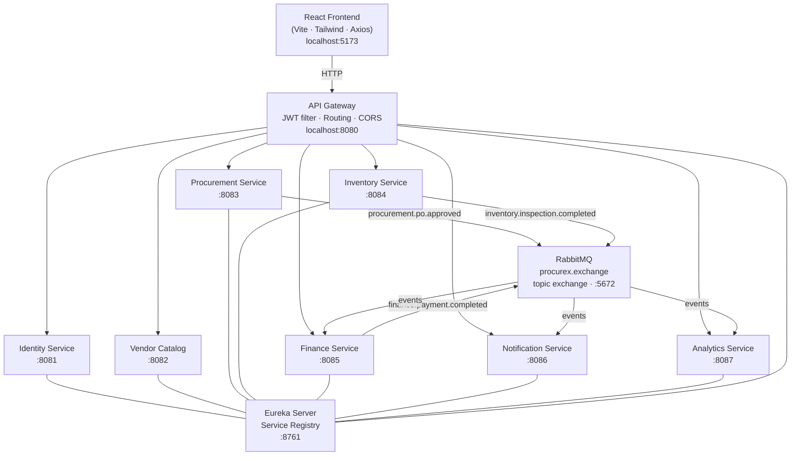
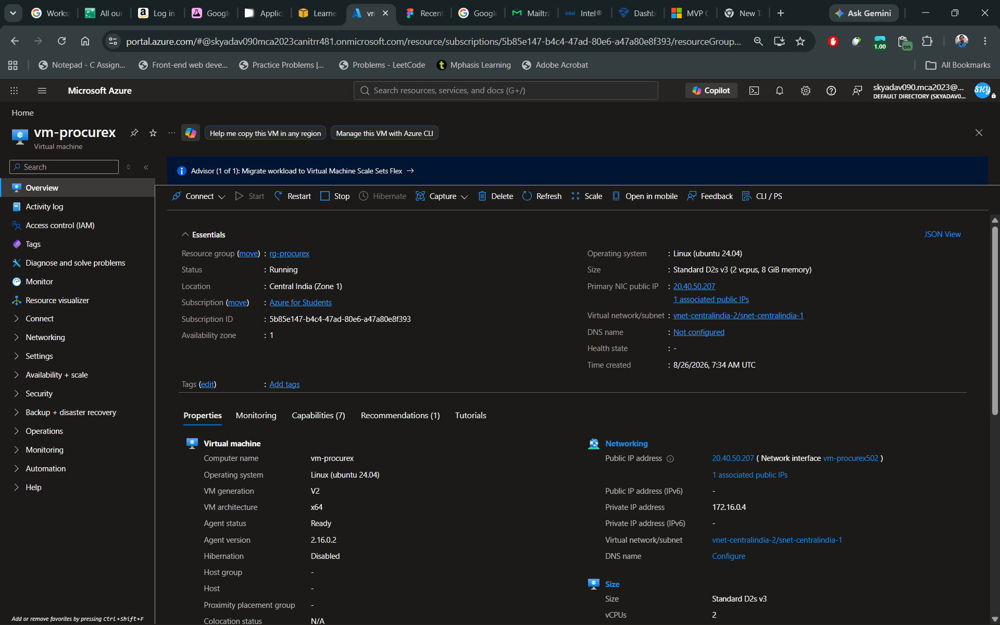
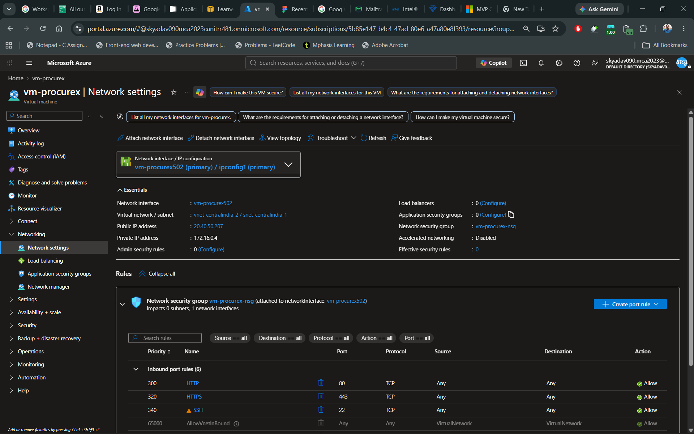
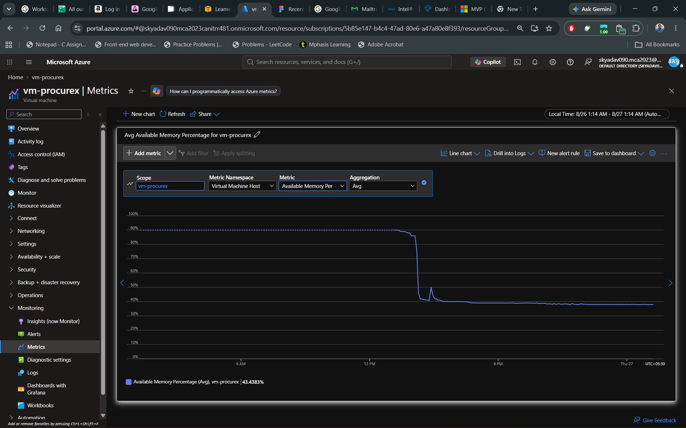
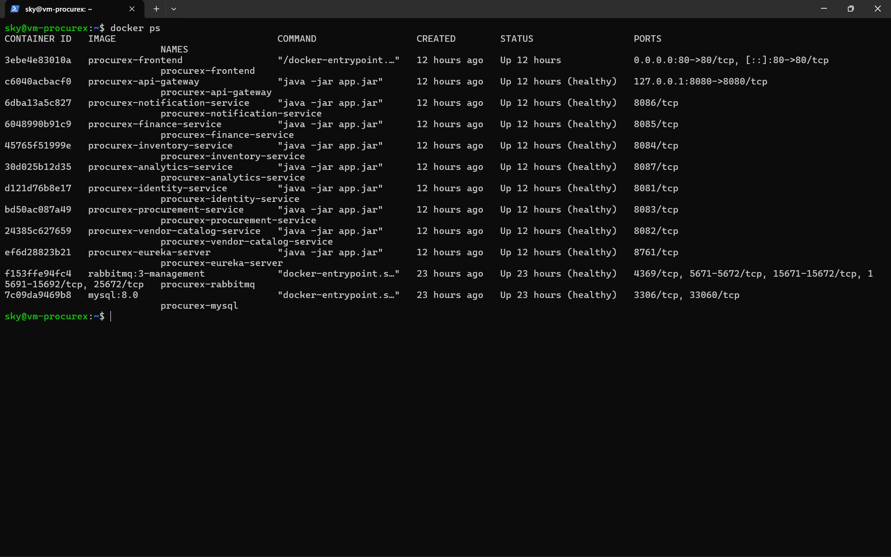
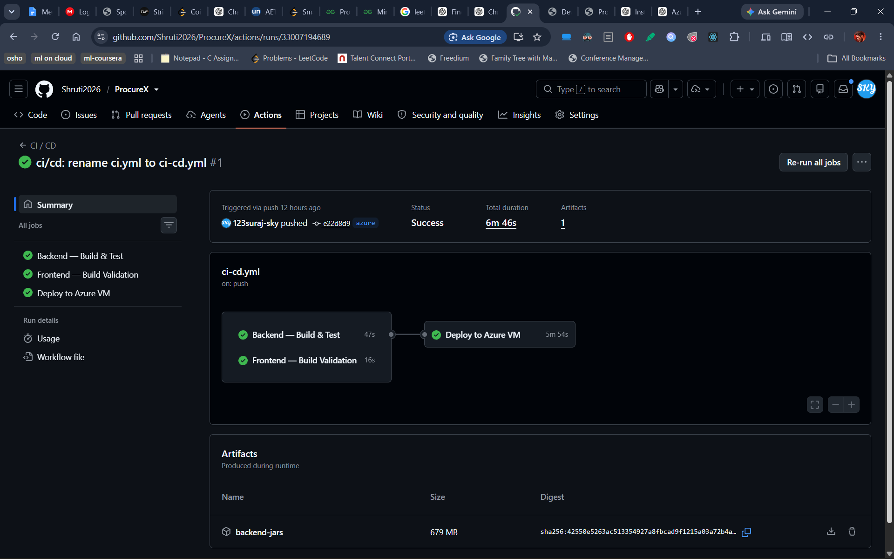
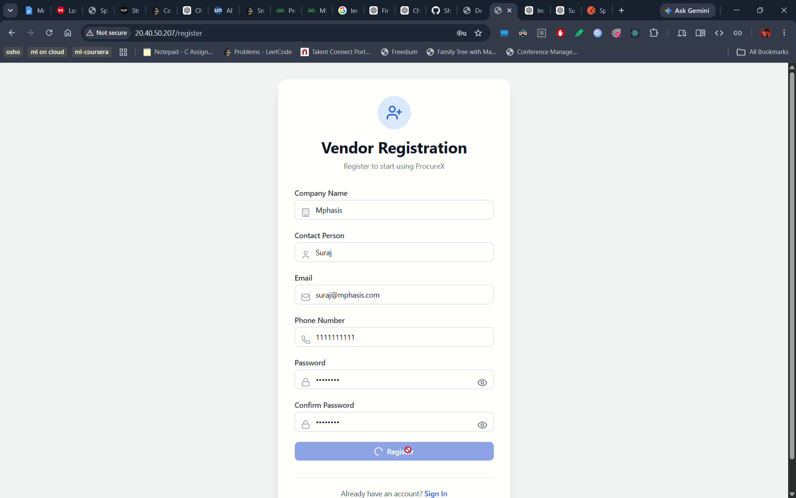
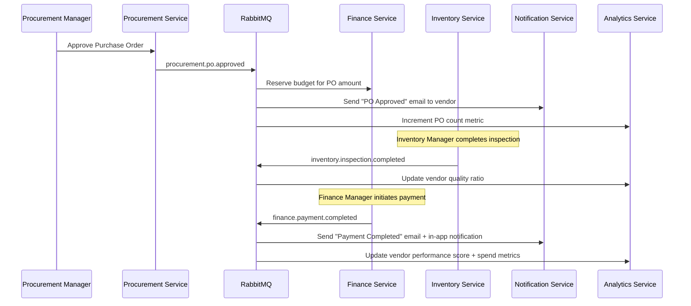

# ProcureX

A full-stack enterprise procurement management system built with a **microservices architecture**. ProcureX digitises the end-to-end procurement lifecycle — from raising a purchase requisition through vendor selection, purchase orders, goods receipt, quality inspection, invoice verification, and payment — with real-time event-driven updates and role-based access control across five distinct user roles.

> **Stack:** Java 21 · Spring Boot 4 · Spring Cloud · React · Vite · Tailwind CSS · MySQL · RabbitMQ · Docker

---

## Table of Contents

- [Features](#features)
- [Architecture](#architecture)
- [Services](#services)
- [Tech Stack](#tech-stack)
- [Screenshots](#screenshots)
- [Getting Started](#getting-started)
  - [Prerequisites](#prerequisites)
  - [Option 1 — Docker (Recommended)](#option-1--docker-recommended)
  - [Option 2 — Docker Dev Mode (Hot Reload)](#option-2--docker-dev-mode-hot-reload)
  - [Option 3 — Local Without Docker](#option-3--local-without-docker)
  - [Frontend](#frontend-setup)
- [Environment Variables](#environment-variables)
- [Service URLs & API Docs](#service-urls--api-docs)
- [User Roles](#user-roles)
- [Event Flow](#event-flow)
- [Running Tests](#running-tests)
- [Azure Deployment](#azure-deployment)
- [CI/CD](#cicd)
- [Contributing](#contributing)

---

## Features

### Procurement Manager
- Create and manage **Purchase Requisitions** with dynamic line items
- Issue **Requests for Quotation** to multiple vendors with closing-date countdown
- Compare vendor quotations side-by-side and select the best offer
- Generate and **approve Purchase Orders** with full status history timeline
- Real-time **Procurement Dashboard** with KPI cards and spend charts

### Vendor
- Submit quotations against open RFQs with unit pricing and lead times
- Accept or decline issued Purchase Orders
- Upload invoices against accepted POs

### Inventory Manager
- Receive goods via a **3-step GRN creation wizard**
- Conduct **quality inspections** per GRN item (accepted / rejected quantities)
- Automatic stock level updates with low-stock row highlighting
- Manage warehouses and view paginated stock transaction log

### Finance Manager
- **3-way match** engine — validates invoice quantity and price against PO and GRN inspection
- Approve or reject invoices with discrepancy flags
- Manage department **budgets** with utilization progress bars
- Initiate payments and track transaction history

### Admin
- Create and manage internal user accounts
- Approve or reject vendor registrations
- Lock / unlock user accounts

### Platform-Wide
- JWT-based authentication with silent refresh via HttpOnly cookie
- Role-based route guards on both frontend and backend
- **RabbitMQ event backbone** — 8 business events published and consumed across services
- Dead Letter Queue (DLQ) for failed message handling
- **In-app notifications** with unread badge and email delivery via SMTP
- **Analytics dashboard** — vendor performance scorecard, spend-by-department chart, spend-over-time line chart
- Swagger/OpenAPI documentation on every service
- Full Docker Compose orchestration for one-command startup

---

## Architecture



All services are backed by independent MySQL databases and communicate asynchronously via RabbitMQ using the **Transactional Outbox Pattern** for guaranteed event delivery.

---

## Services

| Service | Port | Responsibility |
|:--------|:----:|:--------------|
| `eureka-server` | 8761 | Service registry — all services register here |
| `api-gateway` | 8080 | Single entry point · JWT validation · header injection · routing |
| `identity-service` | 8081 | Auth (login · refresh · logout · change password) · user management · vendor registration |
| `vendor-catalog-service` | 8082 | Vendor profiles · product categories · product catalog |
| `procurement-service` | 8083 | Purchase Requisitions · RFQs · Quotations · Purchase Orders · Outbox |
| `inventory-service` | 8084 | Warehouses · Goods Receipt Notes · Quality Inspections · Stock Transactions |
| `finance-service` | 8085 | Budgets · Invoice 3-way match · Payments · Outbox |
| `notification-service` | 8086 | In-app notifications · Email delivery (Thymeleaf templates) |
| `analytics-service` | 8087 | KPI metrics · Vendor performance scorecards · Spend reports |

---

## Tech Stack

### Backend
| Layer | Technology |
|:------|:-----------|
| Language | Java 21 |
| Framework | Spring Boot 4.1 |
| Service Discovery | Spring Cloud Netflix Eureka |
| API Gateway | Spring Cloud Gateway |
| Inter-service calls | OpenFeign |
| Persistence | Spring Data JPA / Hibernate |
| Database | MySQL 8.0 |
| Migrations | Flyway |
| Security | Spring Security 6 · JWT (HS256) |
| Messaging | RabbitMQ 3.12 (topic exchange · DLQ) |
| API Docs | SpringDoc OpenAPI 3 (Swagger UI) |
| Build | Maven 3.9 |
| Container | Docker · Docker Compose |

### Frontend
| Layer | Technology |
|:------|:-----------|
| Framework | React 18 |
| Build tool | Vite |
| Styling | Tailwind CSS |
| Routing | React Router v6 |
| HTTP | Axios (with 401 silent-refresh interceptor) |
| Forms | React Hook Form · Yup |
| Charts | Recharts |
| Icons | Lucide React |
| Toasts | Sonner |

---

## Screenshots

### Azure VM — Infrastructure
| VM Overview | Network / NSG | Memory Metrics |
|:-----------:|:-------------:|:--------------:|
|  |  |  |

### Running on Azure
| Docker Containers | CI/CD Pipeline | Vendor Registration |
|:-----------------:|:--------------:|:-------------------:|
|  |  |  |

---

## Getting Started

### Prerequisites

**For Docker-based setup (recommended):**
- [Docker Desktop](https://www.docker.com/products/docker-desktop/) with Docker Compose v2
- At least 8 GB RAM allocated to Docker

**For local development (without Docker):**
- Java 21+
- Maven 3.9+
- Node.js 18+ and npm
- MySQL 8.0
- RabbitMQ 3.12

---

### Option 1 — Docker (Recommended)

The fastest way to run the full stack. Docker Compose starts MySQL, RabbitMQ, Eureka, the API Gateway, and all 7 microservices.

**Step 1 — Create your environment file**
```bash
cd backend
cp .env.example .env
# Edit .env and fill in DB_PASSWORD, JWT_SECRET, and SMTP credentials
```

**Step 2 — Build all service JARs**
```bash
cd backend
mvn clean package -DskipTests
```

**Step 3 — Start everything**
```bash
docker compose up -d
```

Services start in dependency order (MySQL + RabbitMQ → Eureka → microservices → API Gateway). Allow ~90 seconds for all services to register with Eureka.

**Step 4 — Verify**
```bash
docker compose ps
# Open http://localhost:8761 — all 7 services should show UP
```

**Step 5 — Stop**
```bash
docker compose down          # stops containers, keeps data volumes
docker compose down -v       # stops containers and deletes all data
```

---

### Option 2 — Docker Dev Mode (Hot Reload)

Compiles and runs Java **inside Docker** with Spring Boot DevTools. Useful when you want Docker networking but still want fast code changes.

```bash
cd backend
docker compose -f docker-compose.yml -f docker-compose.dev.yml up -d
```

After changing a source file, trigger recompile:
```bash
docker compose exec <service-name> mvn compile -pl <service-name> -am
```

Spring Boot DevTools detects the new class files and restarts the service automatically.

---

### Option 3 — Local Without Docker

**Step 1 — Start MySQL and RabbitMQ** (via your preferred method — XAMPP, Homebrew, native install)

**Step 2 — Use the startup script (Windows)**
```batch
cd backend
.\start-backend.bat
```

**Or start each service manually** in separate terminals (Eureka first, then the rest in any order):
```bash
cd backend/eureka-server   && mvn spring-boot:run
cd backend/api-gateway      && mvn spring-boot:run
cd backend/identity-service && mvn spring-boot:run
# ... repeat for each service
```

**Service startup order matters:** Eureka must be running before any other service registers.

---

### Frontend Setup

```bash
cd frontend
npm install
npm run dev
```

The app will be available at **http://localhost:5173**

The frontend expects the API Gateway at `http://localhost:8080`. No extra config needed for local development.

---

## Environment Variables

Copy `backend/.env.example` to `backend/.env` and fill in the values. The `.env` file is gitignored and must never be committed.

| Variable | Description | Example |
|:---------|:------------|:--------|
| `DB_PASSWORD` | MySQL root password for all containers | `str0ngP@ssword` |
| `JWT_SECRET` | HS256 signing secret (min 32 chars) | `your-32-char-secret-here` |
| `SMTP_HOST` | SMTP server hostname | `smtp.gmail.com` |
| `SMTP_PORT` | SMTP port | `587` |
| `SMTP_USERNAME` | Sender email address | `noreply@yourcompany.com` |
| `SMTP_PASSWORD` | SMTP app password | `xxxx xxxx xxxx xxxx` |

> **Local dev tip:** Use [Mailhog](https://github.com/mailhog/MailHog) instead of a real SMTP server. Set `SMTP_HOST=mailhog` and `SMTP_PORT=1025`. All outgoing emails are captured in Mailhog's web UI at `http://localhost:8025`.

---

## Service URLs & API Docs

| URL | Description |
|:----|:------------|
| http://localhost:5173 | React frontend |
| http://localhost:8080 | API Gateway (all frontend requests go here) |
| http://localhost:8761 | Eureka Dashboard — service registry |
| http://localhost:15672 | RabbitMQ Management UI (`guest` / `guest`) |
| http://localhost:8083/swagger-ui.html | Procurement Service API docs |
| http://localhost:8085/swagger-ui.html | Finance Service API docs |
| http://localhost:8087/swagger-ui.html | Analytics Service API docs |
| http://localhost:8081/swagger-ui.html | Identity Service API docs |
| http://localhost:8082/swagger-ui.html | Vendor Catalog API docs |
| http://localhost:8084/swagger-ui.html | Inventory Service API docs |
| http://localhost:8086/swagger-ui.html | Notification Service API docs |

---

## User Roles

ProcureX has five distinct roles, each with a dedicated dashboard and route guards on both frontend and backend.

| Role | Dashboard Route | Key Capabilities |
|:-----|:----------------|:----------------|
| `ADMIN` | `/admin/dashboard` | User management · vendor approval · lock/unlock accounts |
| `PROCUREMENT_MANAGER` | `/procurement/dashboard` | Requisitions · RFQs · quotation comparison · PO approval · analytics |
| `VENDOR` | `/vendor/dashboard` | Quotation submission · PO accept/decline · invoice upload |
| `INVENTORY_MANAGER` | `/inventory/dashboard` | GRN creation · quality inspection · stock management |
| `FINANCE_MANAGER` | `/finance/dashboard` | Budget management · invoice 3-way match · payment processing |

Default credentials (development seeded data):

| Role | Email | Password |
|:-----|:------|:---------|
| Admin | `admin@procurex.com` | `Admin@123` |
| Procurement Manager | `pm@procurex.com` | `Manager@123` |
| Finance Manager | `fm@procurex.com` | `Manager@123` |
| Inventory Manager | `im@procurex.com` | `Manager@123` |
| Vendor | `vendor@acme.com` | `Vendor@123` |

---

## Event Flow

ProcureX uses a **RabbitMQ topic exchange** (`procurex.exchange`) with the Transactional Outbox Pattern. Every event is written to an `outbox_events` table in the same transaction as the business operation, then polled and published to RabbitMQ every 5 seconds.



Failed messages are routed to `procurex.dlq` (dead letter queue) for inspection and replay.

---

## Running Tests

Unit and integration tests are available for the Procurement, Finance, and Analytics services.

```bash
# Run all tests
cd backend
mvn test

# Run tests for specific services only
mvn test -pl procurement-service,finance-service,analytics-service -am

# Run only unit tests (skip integration tests)
mvn test -pl procurement-service -Dtest="*ServiceTest" -am
```

**Test coverage:** 49 tests total
- 34 unit tests across `RequisitionService`, `RFQService`, `PurchaseOrderService`, `QuotationService`, `BudgetService`, `InvoiceService`, `PaymentService`, `AnalyticsService`
- 9 integration tests across `RequisitionController` and `InvoiceController` (full Spring context, H2 in-memory database)

Tests use H2 in-memory database (`MODE=MySQL`) with Flyway, RabbitMQ, and Eureka disabled via the `test` profile.

---

## Azure Deployment

ProcureX has been deployed to an Azure VM. The setup uses Docker Compose for orchestration with GitHub Actions for CI/CD.

### VM Requirements
- **OS:** Ubuntu 22.04 LTS
- **Size:** Standard D4s_v3 (4 vCPU / 16 GB RAM) or larger
- **Ports open (NSG inbound rules):** 22 (SSH, your IP only), 80 (HTTP), 443 (HTTPS)

### First-Time Setup

```bash
# 1. Clone the repo on the VM
git clone https://github.com/Shruti2026/ProcureX.git /opt/procurex
cd /opt/procurex

# 2. Create the production secrets file
cp backend/.env.example backend/.env
nano backend/.env   # fill in all values

# 3. Build all JARs
cd backend && mvn clean package -DskipTests

# 4. Start everything
docker compose up -d --build
```

### Redeployment

```bash
cd /opt/procurex
git pull
cd backend && mvn clean package -DskipTests && cd ..
docker compose up -d --build
```

To redeploy a single service without restarting others:
```bash
docker compose up -d --build --no-deps identity-service
```

### Useful VM Commands

```bash
# Live logs
docker logs procurex-identity-service -f --tail=100

# Resource usage
docker stats

# MySQL backup
docker exec procurex-mysql mysqldump -uroot -p"$DB_PASSWORD" \
  --all-databases > backup_$(date +%Y%m%d_%H%M%S).sql

# Access RabbitMQ UI via SSH tunnel (from your local machine)
ssh -L 15672:localhost:15672 azureuser@<VM_IP>
# Then open http://localhost:15672
```

---

## CI/CD

Two GitHub Actions workflows handle automated testing and deployment:

**`.github/workflows/ci.yml`** — runs on every push and PR
- Compiles all backend modules
- Runs the full test suite (`mvn clean verify`)
- Builds the Vite frontend to catch TypeScript/JSX errors

**`.github/workflows/cd.yml`** — runs after CI passes on the `azure` branch
- Downloads compiled JARs from the CI artifact
- SSHes into the Azure VM
- Rsyncs updated files and rebuilds Docker images
- Verifies the API Gateway health endpoint becomes healthy within 5 minutes

Required GitHub Secrets:

| Secret | Value |
|:-------|:------|
| `VM_HOST` | Azure VM public IP or DNS name |
| `VM_USER` | SSH username (e.g. `azureuser`) |
| `VM_SSH_KEY` | Private SSH key contents (`~/.ssh/id_rsa`) |

---

## Contributing

1. Fork the repository
2. Create a feature branch from `master`:
   ```bash
   git checkout -b feat/your-feature-name
   ```
3. Make your changes — follow the existing code style (Java: Google Java Style, Frontend: Prettier defaults)
4. Write or update tests for any logic changes
5. Ensure the build passes:
   ```bash
   cd backend && mvn clean package
   ```
6. Commit with a clear message:
   ```
   feat(procurement): add bulk requisition import from CSV
   ```
7. Open a Pull Request against `master` with a description of what changed and why

### Branch Naming Convention

| Prefix | Use for |
|:-------|:--------|
| `feat/` | New features |
| `fix/` | Bug fixes |
| `docs/` | Documentation only |
| `test/` | Adding or fixing tests |
| `chore/` | Build, tooling, dependency updates |
| `refactor/` | Code restructuring without behaviour change |

---

## License

This project is licensed under the [MIT License](LICENSE).

---

<p align="center">Built with Java, Spring Boot, React, and RabbitMQ</p>
